<div align="center">

# AI app builder for Android - Create apps from voice - 🌰 Acornix

## Vibe code app builder

### Vibe code apps and games on your phone. Create apps from your voice, text or a photo.


**Vibe coding in your pocket.** Describe an app, a game or a tool, and watch the AI write it live. Seconds later it runs full screen on your phone, saves its own data and can sit on your home screen like any other app. Or just ask the assistant to do things for you.

[](https://github.com/gonzaroman/acornix/releases/latest)


[](LICENSE)
## Vibe Code apk download
<a href="https://github.com/gonzaroman/acornix/releases/latest/download/acornix.apk"><b>⬇️ Download the APK (free)</b></a>

<br>

https://github.com/user-attachments/assets/d9b09e3d-3a41-4094-82b8-69c64a8655c1

</div>

---

## What is Acornix?

Acornix is a **free AI app builder for Android** and a **no-code app creator**: an AI app generator that turns a sentence, your voice or a photo into a working app or game, right on your phone. You bring an API key from your favourite AI (Claude, GPT, Gemini or any OpenAI-compatible model), and Acornix does the rest:

- **Creates apps and games** from a sentence, your voice or a photo, and lets you keep improving them by asking. Out of ideas? **The AI suggests original ones**.
- **Lets you show them off** with a share card: your app, its name and how many seconds it took.
- **Runs them like real apps**: full screen, offline, on your home screen, each with its own private database.
- **Acts as an assistant** that can open apps, search YouTube, set alarms, blink the flashlight in Morse, read and change your apps' data and, if you allow it, tap and type inside other apps for you.
- **Turns your phone or tablet into a desktop** with **AcornixOS**: windows, a Dock and a Launchpad, like a little Mac in your pocket.

No terminal, no server, no account. Everything you create lives on your phone.

> Acornix started as a Python tool for Termux. Version 2.0 is a full native Android app that does everything the old one did and much more. [Looking for the Termux version?](#-looking-for-the-original-termux-version)

---

## ✨ What you can do

### 🛠️ Create apps from text, voice or a photo

Type what you want, **create it from your voice** 🎙️ (voice to app, no typing needed) or attach a reference photo 📎 ("make an app like this"). Pick a type (game, utility, music…) or tap one of the ideas, and Acornix writes a complete, mobile-first web app **live in front of you**.

**✨ Ideas from the AI.** Out of ideas? Your AI suggests original things to build, from sound toys and generative art to science simulations and odd little tools, following the type you picked. Tap one and the full request and the name are filled in for you; tap 🎲 for a new batch. Ideas are cached, so they only cost a few tokens now and then, and you can turn them off in Settings.

When it's done you get an interactive preview, an **Open** button, an **Add to home screen** button and a suggested next improvement. Apply the suggestion or ask for your own changes ("add sound effects", "make the buttons bigger", "add a dark mode"). Every change is saved as a new version.

<p align="center">
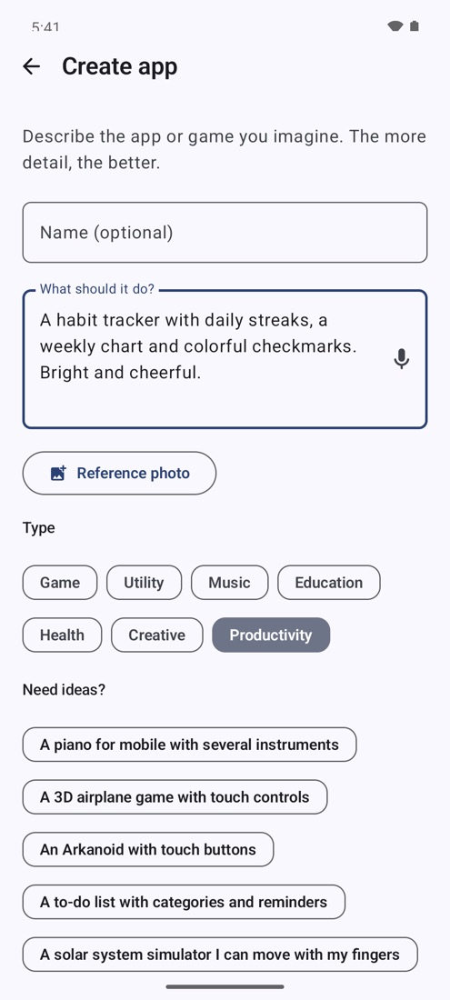&nbsp;&nbsp;
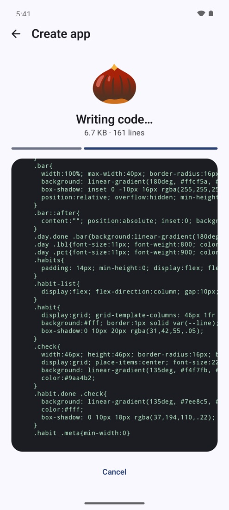&nbsp;&nbsp;
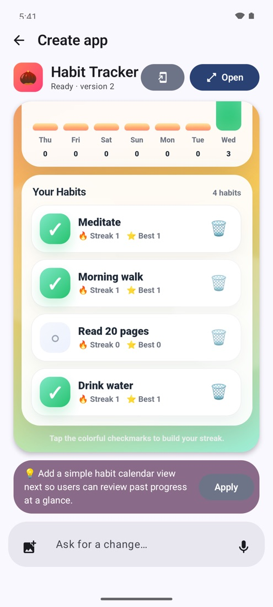
</p>

### 🎮 An AI game builder

Vibe coding a mobile game takes one sentence: *"a platformer with endless levels"*, *"a bowling game you play by swiping"*, *"a castle defense with bosses and an upgrade shop"*. Acornix builds it with touch controls, keeps your saves and high scores in the game's own database, and you can keep asking for more levels, sounds or power-ups.

### 📣 Share what you made

Made something cool? Tap **Share** and Acornix builds a card with **your app running big inside a phone**, its name, how many seconds the AI took to build it and what you asked for. Edit or hide the request, play with the app until it looks just right, then post it on X, Reddit, WhatsApp or anywhere else.

<p align="center">
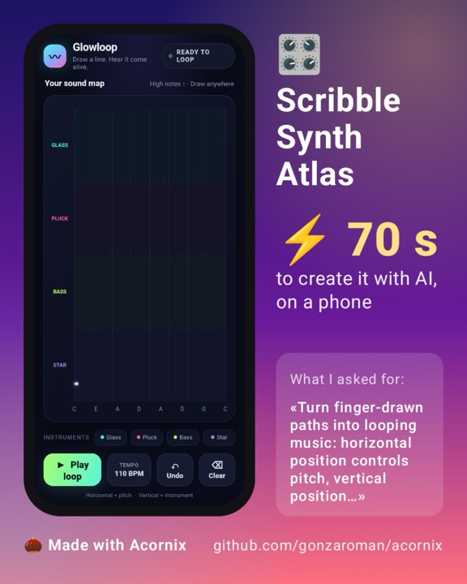&nbsp;&nbsp;
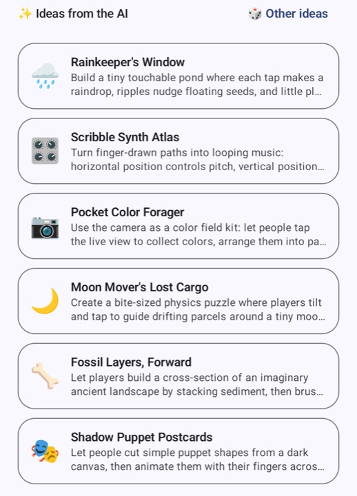
</p>

### 🧬 Functionalities: apps that use your phone

Functionalities are apps that talk to your device through a built-in JavaScript bridge, `window.Acornix`. They can vibrate, switch the flashlight on, speak out loud, read the battery, send notifications, share, copy, open other apps and even **ask the AI** from inside the app. Some examples: a big SOS button, a battery dashboard, a pocket translator that speaks, a Pomodoro timer that vibrates.

### 🤖 An AI assistant that gets things done

One chat for everything. Ask in your own words and the assistant picks the right tools, showing every step it takes:

- *"Create a piano and open it"*
- *"Turn on the flashlight in SOS"* · *"Set an alarm at 7:30"* · *"Start a 10 minute timer"*
- *"Search Nirvana videos on YouTube"* · *"Open Maps and find a pharmacy"*
- *"Add bread to my shopping list"* · *"What's my best score in Bowling?"*
- *"How much battery do I have?"*

**Total control (optional).** Turn on the *Acornix total control* accessibility service and the assistant can also see the screen and tap, type and scroll inside other apps, for example *"open Settings and turn on dark mode"*. It only acts while a task you asked for is running. It **asks before** sending, paying, calling or deleting anything, never sees password fields, and you can stop it at any time from the notification.

<p align="center">
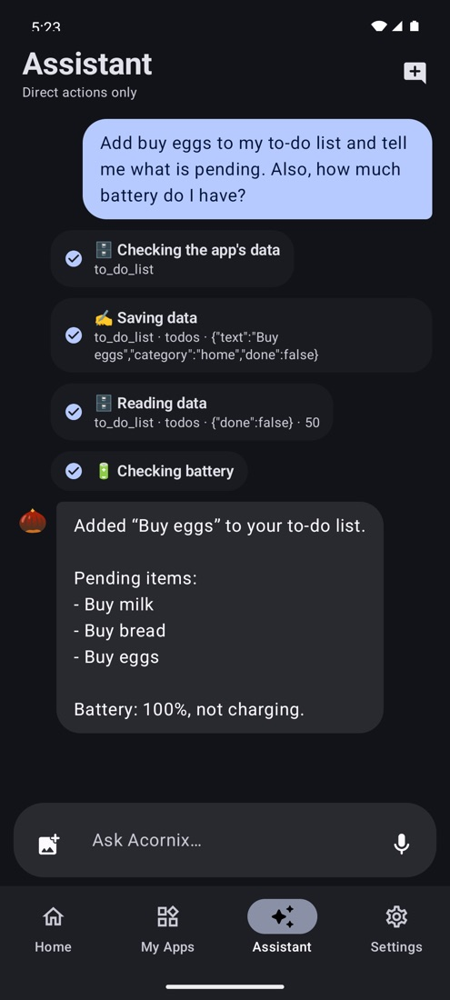
</p>

### 📱 Your apps, like real apps

All your creations live in **My Apps**, a launcher with live thumbnails, search and filters. Tap to open full screen; long-press for more:

- **Improve with AI** or **edit the code** by hand.
- **Versions**: every creation, improvement or edit is kept, and you can restore any of them.
- **Add to home screen**: a real icon that opens the app in its own window, like an installed app.
- **Data**: see, export or clear what the app saved.
- **Share** it as a ZIP, with or without your data, or **rename** and **delete** it.

<p align="center">
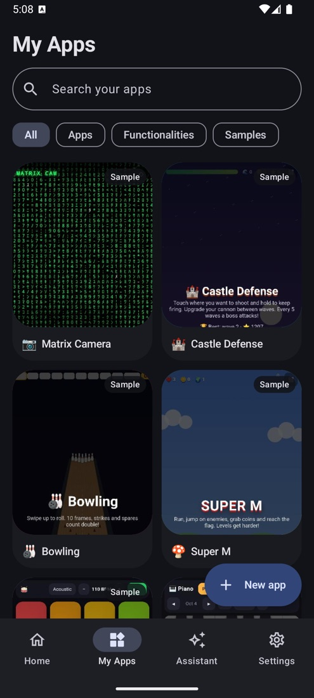&nbsp;&nbsp;
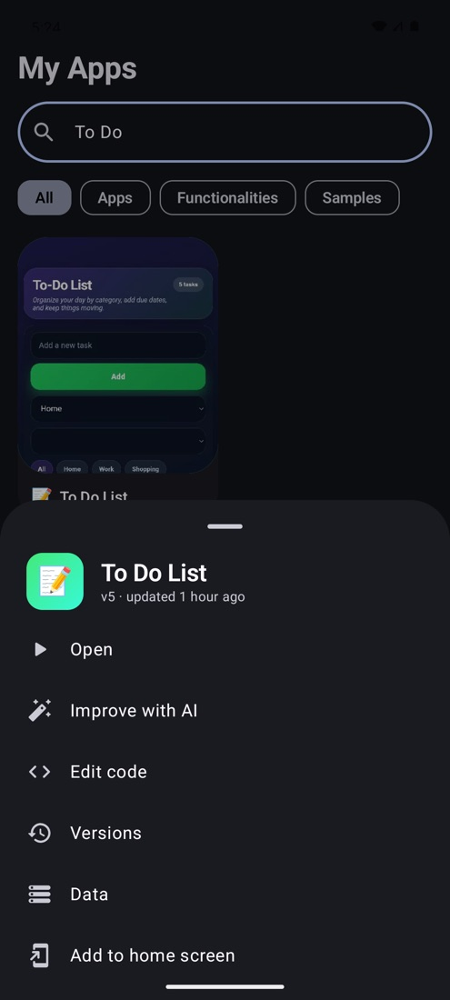
</p>

### 🖥️ AcornixOS: your phone as a computer

Open **AcornixOS** from Tools and your apps become a desktop, inspired by macOS:

- **Windows** you can drag, resize, minimize and maximize, with the classic red, yellow and green buttons. Touch one and it comes to the front.
- A **Dock** with your favourite apps and the ones you have open. Long-press to add or remove.
- A **Launchpad** with all your apps and a search box.
- **Wallpapers** to choose from, and a menu bar with the time and battery.
- Apps open in a **window**; tap the green button (or double-tap the title) to make one full size. On a **tablet** you get several apps side by side, like a real computer.

Every window is the real app, with its own data, camera and files. Add AcornixOS to your home screen and it opens like any other app.

<p align="center">
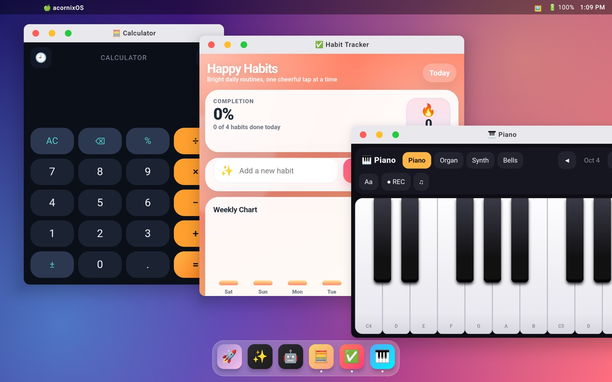
</p>
<p align="center">
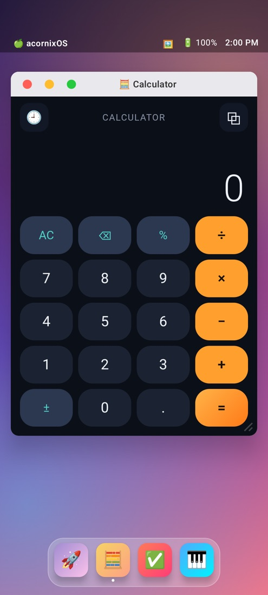&nbsp;&nbsp;
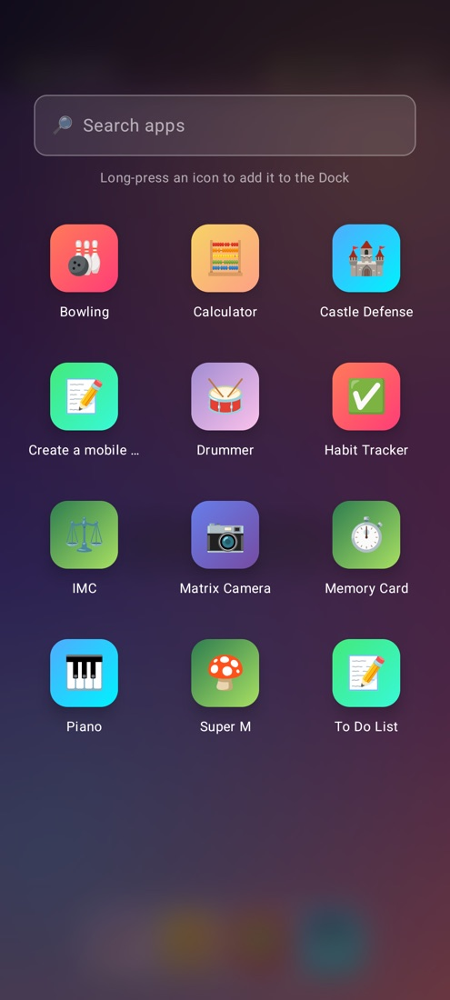
</p>

### 🗄️ A private database for every app

Every app gets its own fast SQLite database (`Acornix.db`), so a to-do list keeps its tasks and a game keeps its saves and high scores. The data:

- **survives improvements**, because the AI is told which collections and fields already exist;
- can be **read and changed by the assistant** ("add eggs to my to-do list");
- can travel inside the app's ZIP;
- is included in backups.

Each app runs on its own isolated origin, so apps never see each other's data.

<p align="center">
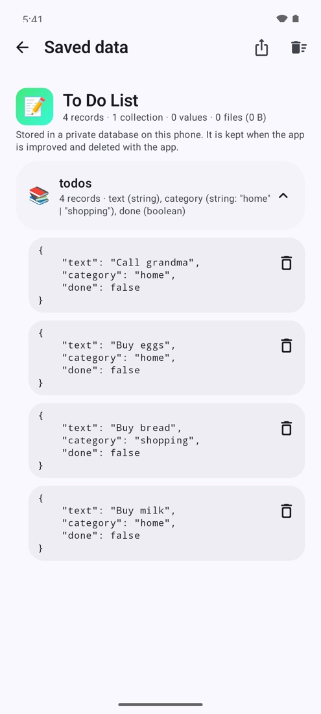
</p>

### ☁️ Backups and sharing

- **Full backup**: one ZIP with all your apps, their versions, data and files. Save it to Google Drive or anywhere else from the system picker, and restore it on any phone.
- **Android backup**: your apps and data are also included in your Google account backup.
- **Import** ZIPs shared by friends, including apps made with the original Termux version of acornix.

### 📋 Manual studio: no API key needed

Don't have an API key? Copy a ready-made prompt, paste it into ChatGPT, Claude or Gemini on the web, then paste the answer back. Acornix checks the code, warns you if something is missing and installs the app.

### 🔔 Always up to date

Acornix checks GitHub for new versions. When one comes out you'll see what's new and can update with one tap, right from the app.

### And more

**Phone status** (battery, memory, storage), Material You colors with light and dark themes, and an interface in **English and Spanish**. Generated apps follow your phone's language too.

<p align="center">
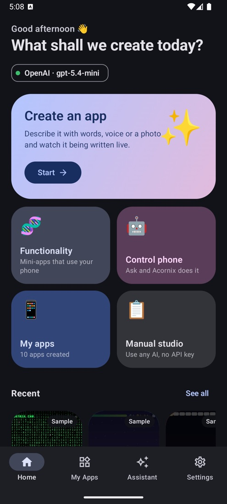&nbsp;&nbsp;
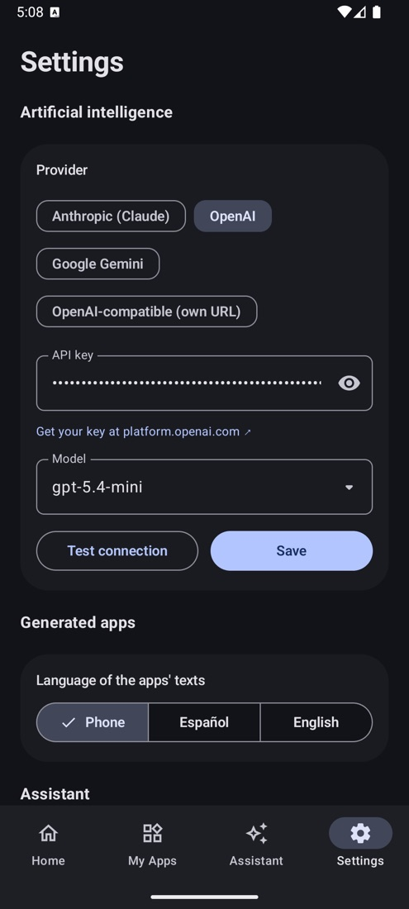
<br><sub>Dark mode too</sub>
</p>

---

## 🎮 Games and apps included

Acornix comes with fourteen example apps. Eight were rebuilt for 2.0: they all work offline, adapt to any screen in portrait or landscape, and save their data with `Acornix.db`.

| | | | |
|:---:|:---:|:---:|:---:|
| 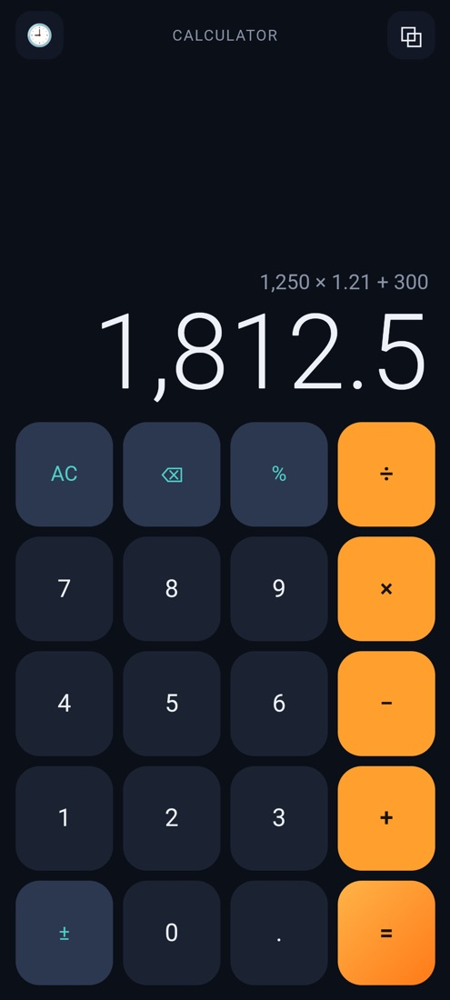<br>**Calculator**<br><sub>History saved, proper operator precedence</sub> | 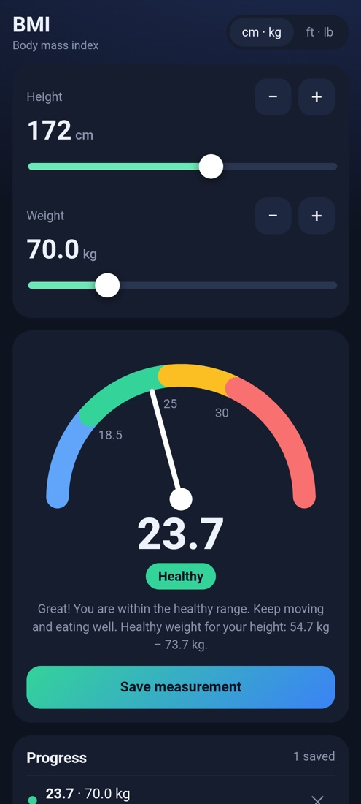<br>**BMI**<br><sub>Gauge, healthy range and progress chart</sub> | 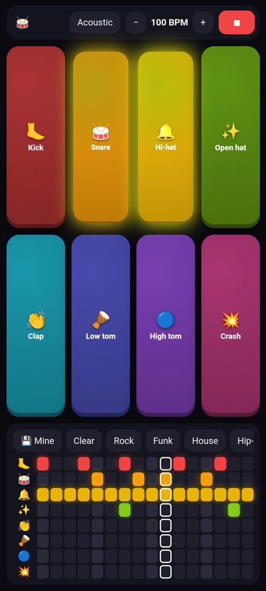<br>**Drummer**<br><sub>8 pads, 16-step sequencer, saved beats</sub> | 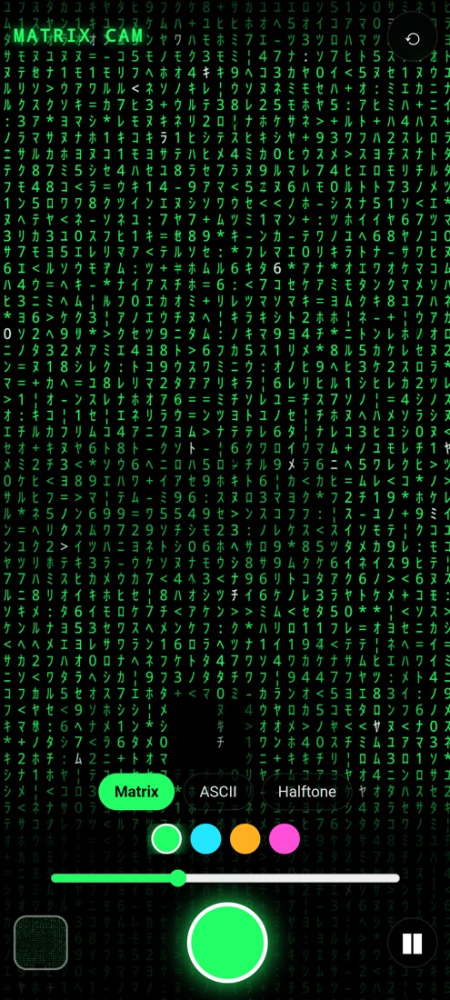<br>**Matrix Camera**<br><sub>Live Matrix / ASCII / halftone camera</sub> |
| 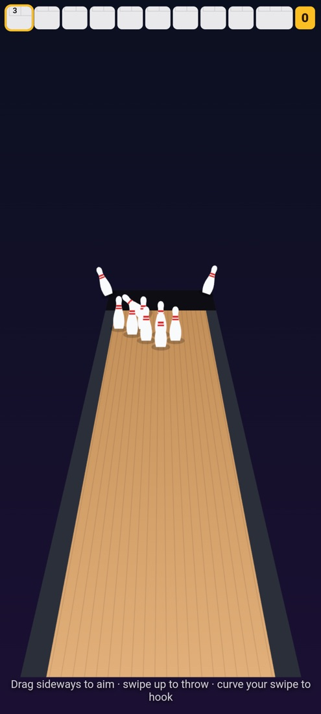<br>**Bowling**<br><sub>Swipe to throw, hook spin, real scoring</sub> | 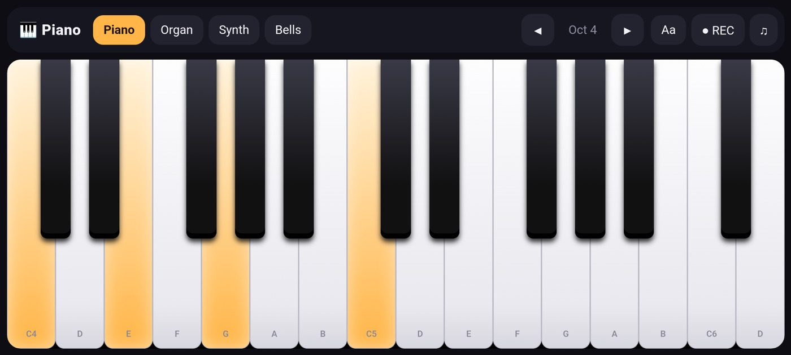<br>**Piano**<br><sub>4 instruments, multitouch, recordings</sub> | 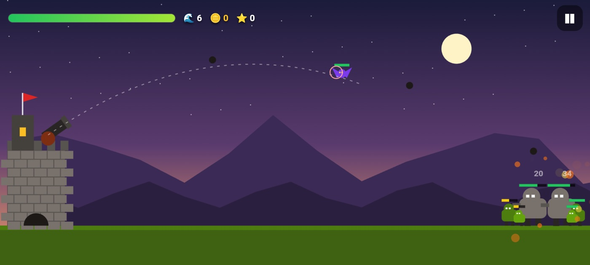<br>**Castle Defense**<br><sub>Waves, bosses and an upgrade shop</sub> | 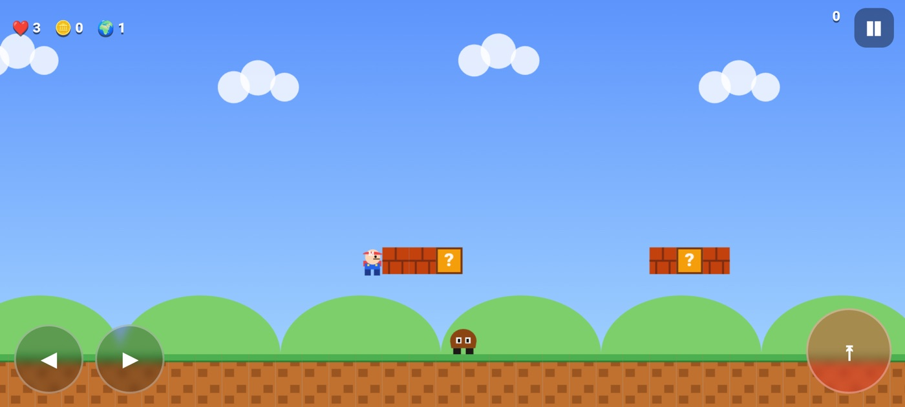<br>**Super M**<br><sub>Platformer with endless levels</sub> |

The other six were made with AI on a phone, each from a single request and one improvement, for our step-by-step videos, and they are included exactly as they came out. Reef Aquarium loads its 3D engine from the internet.

| | | |
|:---:|:---:|:---:|
| 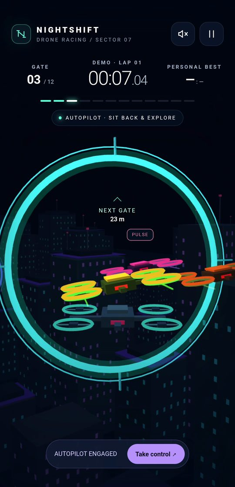<br>**Neon Drone Race**<br><sub>3D race through neon rings, with rival drones</sub> | 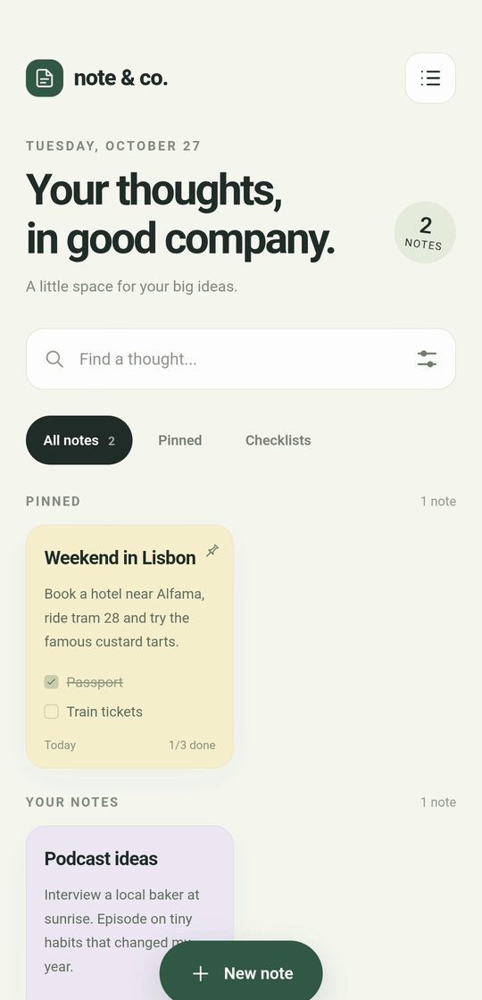<br>**Notes**<br><sub>Checklists, pinned notes, colors and search</sub> | 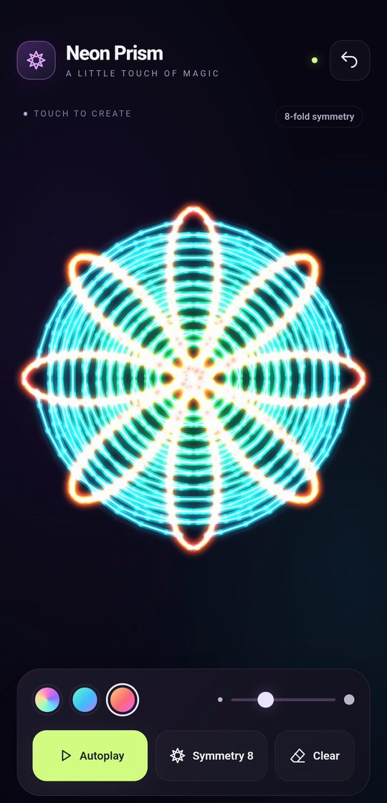<br>**Neon Kaleidoscope**<br><sub>8-way mirrored neon drawing and a galaxy mode</sub> |
| 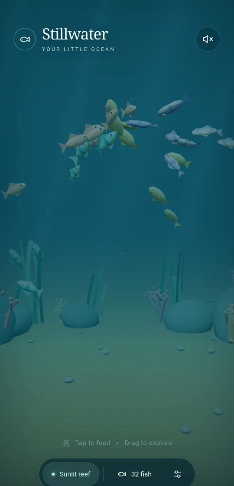<br>**Reef Aquarium**<br><sub>Feed the fish; glowing jellyfish at night</sub> | 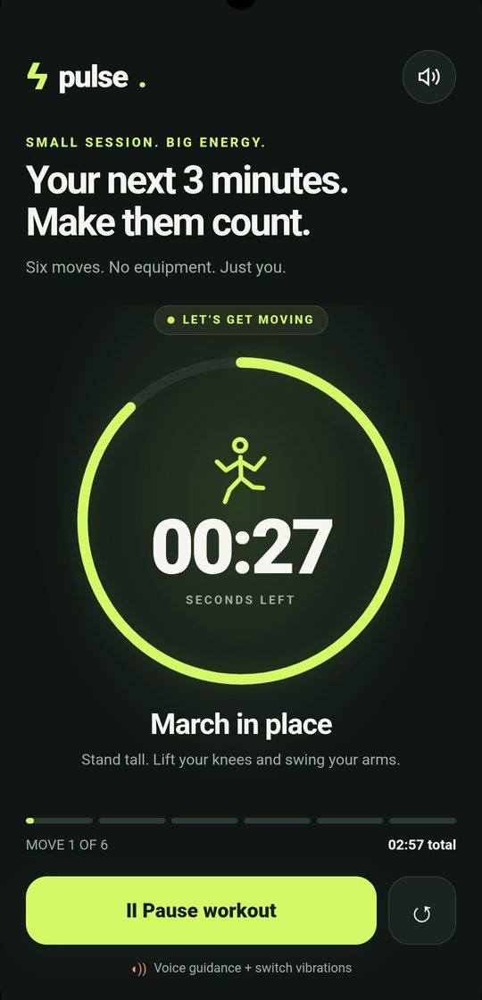<br>**Pocket Coach**<br><sub>A workout coach that talks and vibrates</sub> | 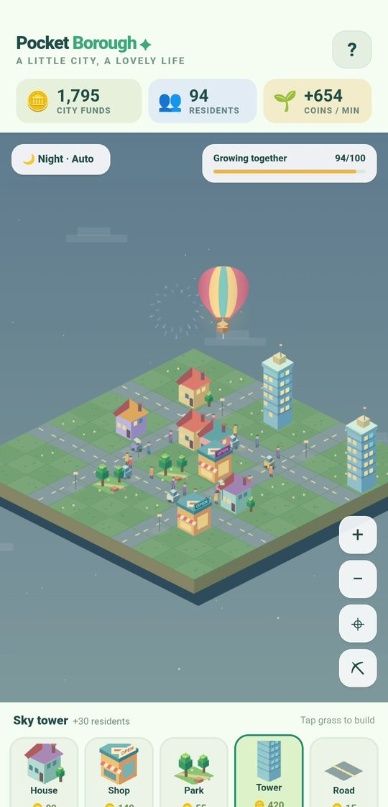<br>**Pixel City**<br><sub>Build a city, day and night, fireworks</sub> |

---

## 📲 Download the APK and install

Acornix is free: download the APK from GitHub releases and install it in a minute.

1. **Download** [`acornix.apk`](https://github.com/gonzaroman/acornix/releases/latest/download/acornix.apk) from the [latest release](https://github.com/gonzaroman/acornix/releases/latest) on your phone.
2. **Open it.** If Android asks, allow your browser or file manager to install apps, then tap **Install**. Google Play Protect may warn you because the app doesn't come from the Play Store; tap **More details › Install anyway**.
3. **Open Acornix** and follow the three-step welcome: choose your AI provider, paste your API key and tap **Test connection**.

**Requirements:** Android 8.0 or newer, and an API key from one of these providers:

| Provider | Where to get a key | Notes |
|---|---|---|
| **Anthropic (Claude)** | [console.anthropic.com](https://console.anthropic.com/settings/keys) | Excellent for code; uses the official Anthropic SDK |
| **OpenAI** | [platform.openai.com](https://platform.openai.com/api-keys) | Any chat model your account can use |
| **Google Gemini** | [aistudio.google.com](https://aistudio.google.com/apikey) | Has a free tier |
| **OpenAI-compatible** | OpenRouter, Groq, Together, a local Ollama… | Set your own base URL |

Tap **▾** next to *Model* in Settings to load the models available to your account.

**Updating:** Acornix tells you when there's a new version. Tap **Update** and Android installs it over the current one, keeping all your apps and data. The first time, Android will ask you to allow Acornix to install apps.

**Total control (optional):** Android *Settings › Accessibility › Acornix total control › On*. You can also get there from the Assistant or from Acornix Settings.

---

## 🔐 Privacy and security

- **Your API key** is encrypted with the Android Keystore and only ever sent to the provider you chose.
- **Your apps and their data** stay on your phone, except for what you send to your AI provider when you create or improve something. Acornix has no servers, accounts or analytics.
- **Each app is sandboxed** on its own origin with its own database. The phone bridge only answers that app's own pages.
- **The assistant asks first** before sending messages, calling, paying, buying or deleting. It never sees password fields, and a notification with a **Stop** button is shown while it works.

---

## 🧑‍💻 For creators: the `window.Acornix` API

Every app made with Acornix can use this API, and so can your own HTML apps imported as a ZIP, whether you write them by hand or with your favourite AI coding assistant. All calls return Promises.

```js
// Phone
await Acornix.vibrate(200);                 // or a pattern: [100, 50, 100]
await Acornix.flashlight(true);
await Acornix.speak('Hello!', 'en-US');
await Acornix.notify('Timer', 'Time is up');
await Acornix.toast('Saved');
const { level, charging } = await Acornix.battery();
const info = await Acornix.deviceInfo();
await Acornix.share('Look what I made');
await Acornix.openUrl('https://example.com');

// Your AI, inside the app (the user's own model and key)
const fact = await Acornix.askAI('Give me a fun fact about acorns');
const plant = await Acornix.askAI('What plant is this?', { images: [videoOrImgOrFile] }); // camera frame, , file…
const plan = await Acornix.askAI('Three dinners with rice and eggs', { json: true });      // → parsed JSON
// options: { system, images (up to 4), json, quick: false for deep thinking }

// Database (private to this app)
const tasks = Acornix.db.collection('tasks');
const t = await tasks.add({ text: 'Buy bread', done: false });     // → {_id, _created, _updated, ...}
await tasks.update(t._id, { done: true });
const pending = await tasks.list({ where: { done: false }, orderBy: '_created', desc: true, limit: 50 });
const big = await tasks.list({ where: { score: { $gt: 100 } } });  // $gt $gte $lt $lte $ne $in $contains
await Acornix.db.set('highScore', 1200);
const best = await Acornix.db.get('highScore');

// Files (photos, drawings, exports…)
const file = await Acornix.files.save('photo.jpg', blob);          // Blob or data URL → {name, url, size}
document.querySelector('img').src = file.url;

// Refresh when the assistant changes your data
window.addEventListener('acornixdata', () => reload());
```

If `window.Acornix` is missing (the app was opened in a normal browser), fall back to `localStorage`. Apps generated by Acornix already do this.

---

## 🛠️ Build from source

You need Android Studio Ladybug or newer (AGP 8.7) and the Android SDK 35.

```bash
git clone https://github.com/gonzaroman/acornix.git
cd acornix
./gradlew assembleDebug          # app/build/outputs/apk/debug/app-debug.apk
./gradlew testDebugUnitTest      # unit tests
```

Release builds are signed with a keystore kept outside the repository: `-PacornixSigning=/path/to/keystore.properties`, with `storeFile`, `storePassword`, `keyAlias` and `keyPassword`. Without it, release builds are unsigned.

<details>
<summary><b>Project structure</b></summary>

```
app/src/main/java/com/gonzaroman/acornix/
├── ai/        AI providers (Anthropic SDK, OpenAI & compatible, Gemini), streaming, tool calling
├── core/      Prompts, response parser, app generator
├── data/      Settings (encrypted keys), apps + versions, per-app SQLite store,
│              ZIP import/export, full backups, sample apps, update checker
├── device/    Phone actions (flashlight, vibration, speech, alarms, intents…), shortcuts
├── control/   Accessibility service for "total control"
├── agent/     Assistant tools and conversation loop
├── web/       Full-screen app runner, per-app origins, window.Acornix bridge
└── ui/        Jetpack Compose screens (Material 3)
app/src/main/assets/sample_apps/   The fourteen example apps
```

**Tech:** Kotlin, Jetpack Compose and Material 3, OkHttp, kotlinx.serialization, DataStore, SQLite, AndroidX WebKit, Coil, and the official Anthropic Java SDK.

</details>

---

## 🌳 Looking for the original Termux version?

Acornix began as an AI-powered Python system for Termux. That version is kept in the [`termux`](https://github.com/gonzaroman/acornix/tree/termux) branch (tag [`v1-termux`](https://github.com/gonzaroman/acornix/releases/tag/v1-termux)). Version 2.0 replaces it: no Termux, Python or local servers needed, just install the app.

---

## 🤝 Contributing

If you like Acornix, a ⭐ on GitHub helps more people find it. Ideas, bug reports and pull requests are welcome. Open an [issue](https://github.com/gonzaroman/acornix/issues) to tell us what you built with Acornix or what you would like it to do next.

## 📄 License

[MIT](LICENSE) © Gonzalo Román Márquez
